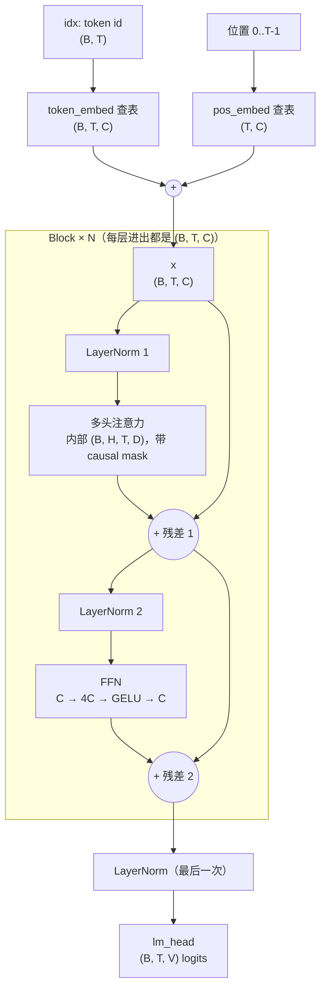

# Week 2 — GPT Forward 数据流

来源：`code/w02_gpt_block.py`（多头注意力 + FFN，pre-norm，叠 N 层）。

## 1. 数据流图



一个 block 的两行公式：

```text
x = x + attn(ln1(x))   # 注意力：token 之间收集信息
x = x + ffn(ln2(x))    # FFN：每个 token 自己消化信息
```

## 2. 形状表

| 步骤 | 形状 |
|------|------|
| 输入 token id | `(B, T)` |
| token 向量 + 位置向量 | `(B, T, C)` |
| 注意力内部（拆头后） | `(B, H, T, D)`，scores 为 `(B, H, T, T)` |
| 注意力输出（拼回） | `(B, T, C)` |
| FFN 中间层 | `(B, T, 4C)` |
| FFN 输出 | `(B, T, C)` |
| 每个 block 输出 | `(B, T, C)` |
| logits | `(B, T, V)` |

## 3. 每个组件：去掉它会怎样

| 组件 | 去掉它会怎样 |
|------|-------------|
| 位置向量 | 注意力只能算出 token 之间的关系，但不知道谁在前谁在后；「狗咬人」和「人咬狗」分不清 |
| 注意力 | token 之间无法交换信息，每个 token 只能看到自己，用不上上下文 |
| FFN | 只剩注意力的「按权重求平均」，没有地方对每个 token 的信息做加工变换，模型能学到的东西大幅减少（FFN 约占 block 参数的 2/3） |
| 残差 | 每层的输出会直接替换原信息；层数一多，训练信号传不回前面的层，深层网络训练不起来 |
| LayerNorm | 数值尺度越算越失控，训练不稳定、loss 降不下来 |

## 4. 易混点（本周踩过的坑）

- 残差是**结构**：一个 block 固定 2 次，和训练步数无关。
- FFN 的形状是 `(B, T, C)`，没有头；`(B, H, T, D)` 只在注意力内部出现。
- FFN **不**在 token 之间交换信息；交换信息只发生在注意力里。
- pre-norm 是**先** LayerNorm **再**进子层；代码 `attn(ln1(x))` 从里往外读。

## 5. 验收两问

**为什么残差连接能让很深的网络训练得动？**

残差给每一层加了一条直达通道。往前算时，原信息能直接穿过后面的层，每层只在上面加修改；训练调权重时，调整信号能沿 `+` 号直接传回前面的层，不会被层层缩小到接近 0。所以层数多了，前面的层也能收到足够的信号，被调整好。

**causal mask 和 padding mask 有什么区别？**

| | causal mask | padding mask |
|--|------------|-------------|
| 挡住什么 | 未来的位置 | 补齐用的 `[PAD]` 位置 |
| 形状特点 | 固定的右上三角 | 每句话不同，取决于补了几个 `[PAD]` |
| 为什么要挡 | 训练时不能偷看答案 | 假数据不能参与注意力计算 |

顺序：先用 `[PAD]` 把短句补齐，再用 padding mask 把这些位置挡住。两种 mask 可同时使用。
